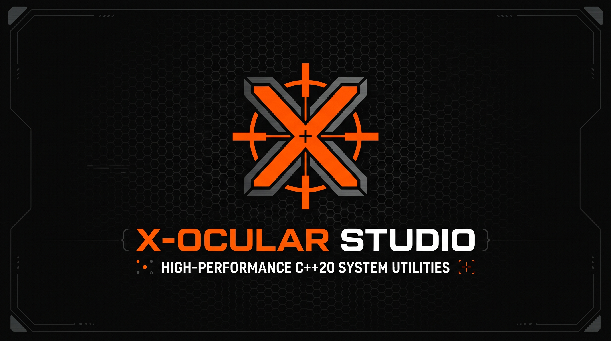

  

<h1>X-APEX BOOTSTRAPPER</h1>

**Lightweight, high-performance C++20 Roblox Bootstrapper with custom FastFlags, client mods, and Discord RPC by X-Ocular Studio.**

---

## // OVERVIEW

**X-Apex Bootstrapper** is a native **C++20 / Win32** Roblox launcher engineered by **X-Ocular Studio** for maximum system efficiency, zero background bloat, and complete client customization. Built with a hardware-accelerated **WebView2** interface, X-Apex delivers full control over your Roblox client while maintaining **0% idle CPU usage** and **~0.1% RAM footprint**.

---

## // CORE FEATURES

* **⚡ FastFlags Engine:** Configure quick presets (FPS Unlock, Direct3D 11 / Vulkan, Voxel/Future lighting, MSAA, Disable Shadows) or edit `ClientAppSettings` directly via a built-in **Table Editor** and **Raw JSON Code** view.
* **🛠️ Global Settings Control:** Modify Roblox's internal settings (custom FPS cap, fullscreen mode, master volume, mouse sensitivity) without launching the game, with an option to lock files as **Read-Only**.
* **🎨 Client Mods & Overrides:** Easily apply custom game fonts (`.ttf`/`.otf`), custom death sounds (`.ogg`/`.mp3`), custom mouse cursors, and custom Shift Lock icons.
* **🎮 Discord Rich Presence & Session Tracking:** Automatically displays your active Roblox game, creator, cover art, and elapsed session time directly on your Discord profile.
* **🚀 Advanced Bootstrapper & Deployment:**
  * Multi-instance Roblox support (`ROBLOX_singletonMutex`).
  * Automatic background termination of `RobloxCrashHandler.exe` to free system resources.
  * Version Hash override, clean client reinstallation, and old build cleaner.
  * Full JSON configuration backup (Export / Import) and native borderless Win32 Splash Screen.

---

## // INSTALLATION & BETA TESTING

1. Navigate to the **[Releases](../../releases)** section on the right side of this repository.
2. Download the latest `X-Apex.exe` Beta build (verify the provided **SHA-256** checksum).
3. Run `X-Apex.exe` and complete the initial setup wizard.
4. *(Optional)* Because X-Apex is a newly compiled native binary, Windows SmartScreen may show an *"Unknown Publisher"* prompt on first launch — click **More info → Run anyway**.

---

## // SUPPORT & BUG REPORTS

Found a bug during the Beta phase or need help configuring FastFlags?
* Open X-Apex, go to **Bootstrapper → Open Logs** to grab your diagnostic log file.
* Join our official **X-Ocular Studio Discord Server** and open a ticket in the Support Center.

---

## // LEGAL & COPYRIGHT

© 2026 **X-Ocular Studio**. All Rights Reserved.  
This software is proprietary (closed-source). Unauthorized reproduction, redistribution, reverse engineering, or modification of this binary or any associated assets is strictly prohibited.
